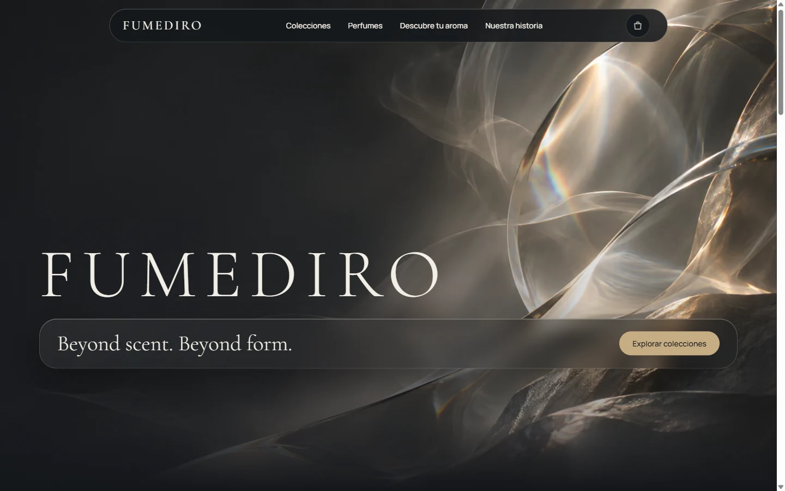
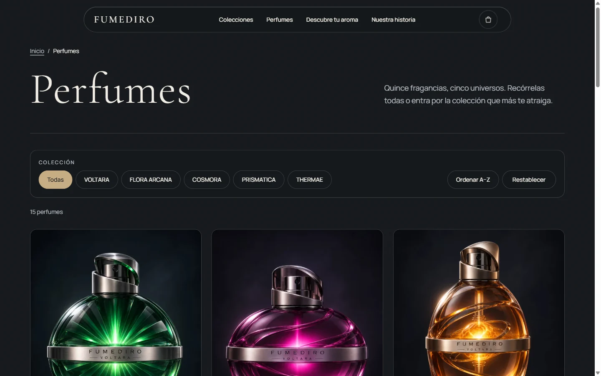
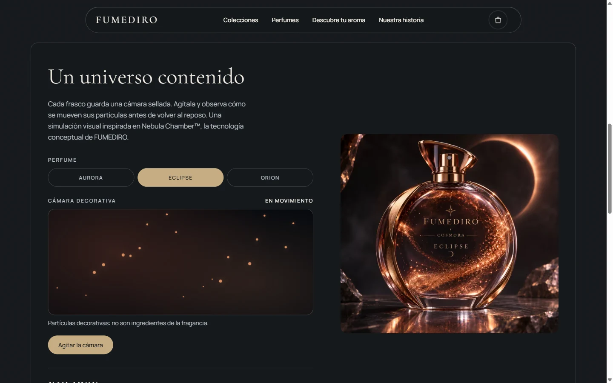
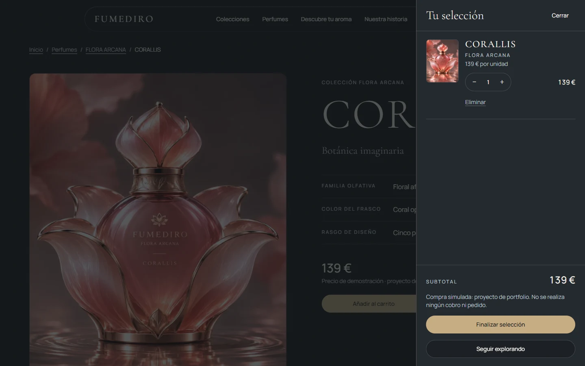
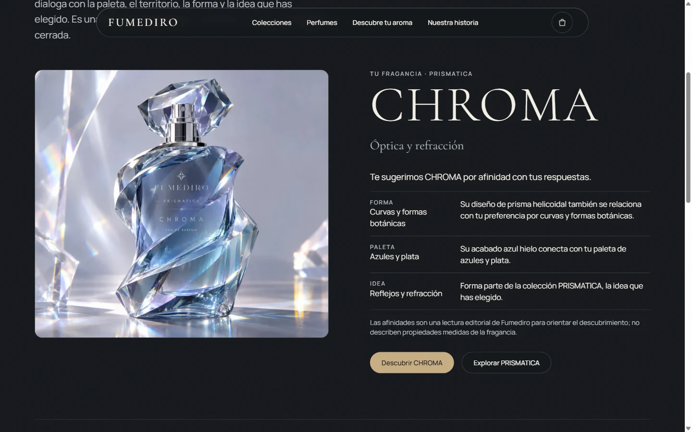
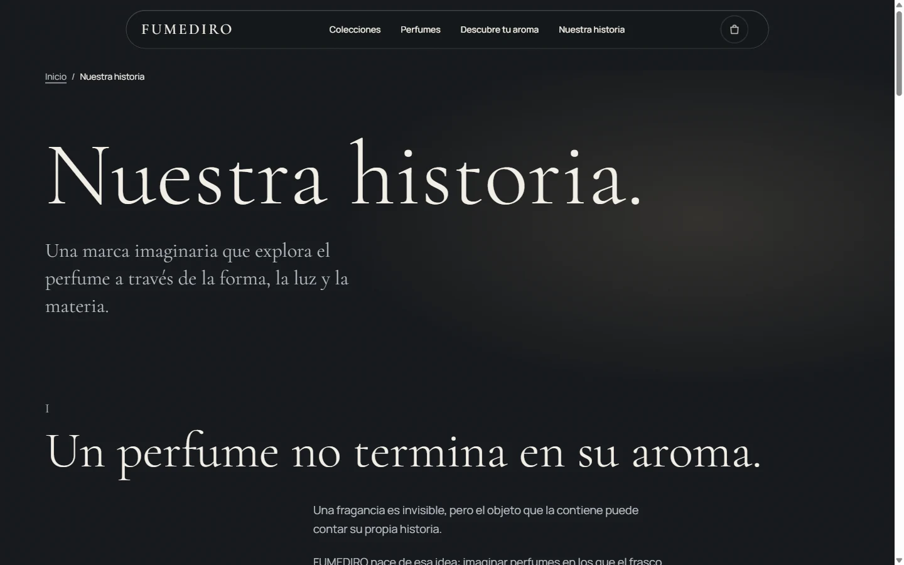
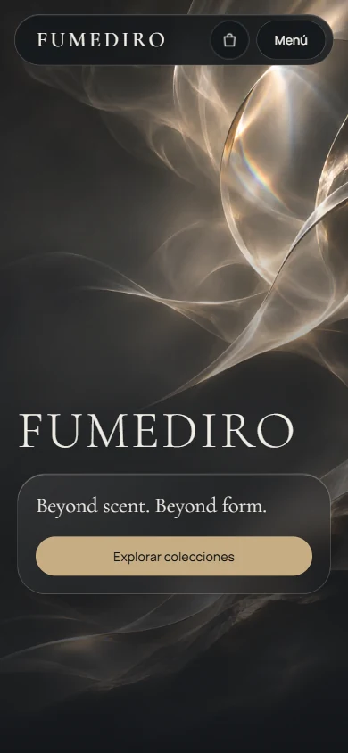

# FUMEDIRO

> **Beyond scent. Beyond form.**

**🔗 [Ver la web en producción: fumediro.vercel.app](https://fumediro.vercel.app)**

> **Marca ficticia y proyecto demostrativo.** FUMEDIRO no es una tienda real: los perfumes, los materiales y DiroCore™ son inventados, los precios son de demostración y no se procesa ningún pago ni pedido.

FUMEDIRO es una marca de perfumería experimental concebida como proyecto de diseño y desarrollo web para portfolio. Imagina perfumes cuyo frasco forma parte de la experiencia: su forma, su color y su relación con la luz. El sitio reúne un catálogo de 15 fragancias en cinco colecciones, cada una con una interacción propia, un carrito de demostración y un cuestionario de recomendación determinista.

## Vista previa



### Descubrir y explorar

| Catálogo | Colección COSMORA |
|---|---|
|  |  |
| Filtro por colección, ordenación y estado en la URL. | Una interacción propia por colección. |

### Experiencia de compra (simulada)

| Ficha de CORALLIS | Carrito |
|---|---|
|  |  |
| Plantilla compartida alimentada por datos tipados. | Panel accesible con persistencia local. |

### The Scent Finder



Recomendación determinista a partir de cuatro preguntas, sin cuentas ni almacenamiento de respuestas.

### Nuestra historia



La idea de marca en cuatro capítulos.

### Adaptación móvil

<p align="center">
  
</p>

*Capturas tomadas el 24-11-2026 en https://fumediro.vercel.app (Chromium vía Playwright, 1440 × 900 y 390 × 844 px, con datos de demostración). Puede haber diferencias con versiones posteriores.*

## Funcionalidades

- **Home editorial** con los cinco universos de la marca.
- **Catálogo de 15 perfumes** con filtro por colección, ordenación y estado en la URL.
- **Cinco colecciones** (VOLTARA, FLORA ARCANA, COSMORA, PRISMATICA, THERMAE), cada una con una interacción propia.
- **Fichas de producto** generadas desde una única fuente de datos tipada.
- **Carrito de demostración** en un panel accesible, con persistencia local.
- **Checkout simulado**: valida un formulario de ejemplo y muestra una confirmación ficticia; no envía nada.
- **The Scent Finder**: cuestionario de cuatro preguntas con una recomendación determinista.
- **Nuestra historia**: la idea de marca en cuatro capítulos.
- **Contacto** (`/contacto`): correo y enlace al portfolio del creador. Sin formulario ni backend; se enlaza desde el pie de página.

## Tecnologías

Versiones instaladas en este repositorio (ver `package-lock.json`):

| Tecnología | Versión |
|---|---|
| Next.js (App Router) | 16.4.6 |
| React | 19.3.1 |
| TypeScript (estricto) | 6.0.3 |
| Tailwind CSS | 4.3.5 |
| Vitest | 5.1.0 |
| ESLint | 9.39.5 |

Tipografías (Cormorant Garamond y Manrope) cargadas con `next/font/google`. Node `>=22.12`.

## Ejecución local

```bash
npm ci               # instala dependencias exactas (o npm install)
npm run dev          # desarrollo en http://localhost:3000
npm run build        # build de producción
npm run start        # sirve el build de producción
npm run typecheck    # next typegen + tsc --noEmit
npm run lint         # eslint
npm test             # vitest run
```

Pruebas: tests unitarios con Vitest sobre las funciones puras (catálogo, filtros, carrito, recomendación). No hay tests de navegador automatizados en el repositorio.

Una integración continua en GitHub Actions (`.github/workflows/ci.yml`) está configurada para ejecutar typecheck, lint, tests y build en cada push y pull request. Este README no recoge resultados de ejecuciones concretas.

## Arquitectura

```
src/app/           Rutas (App Router): /, /perfumes, /colecciones, /descubre-tu-aroma,
                   /historia, /checkout, /contacto y las dinámicas por slug
src/components/    Componentes compartidos (GlassPanel, GlassButton, navegación, tarjetas,
                   drawer del carrito) y experiencias de cada colección
src/data/          Catálogo, colecciones, precios de demostración y textos (datos locales)
src/lib/           Tipos y funciones puras (catálogo, filtros, carrito, recomendación) con tests
public/images/     Fotografías de producto, imágenes del hero e imagen social
docs/screenshots/  Capturas de la web publicada usadas en este README
```

No hay backend, CMS ni servicios externos. No hay una página por perfume: las fichas y colecciones salen de `generateStaticParams` y los datos. Los documentos de especificación (`PRODUCT.md`, `DESIGN.md`, `UX-SPEC.md`, `IMPLEMENTATION-PLAN.md`) y las reglas de trabajo (`CLAUDE.md`) están en la raíz.

## Diseño y accesibilidad

- Estética editorial oscura: carbón, grafito, marfil, plata y champagne; glassmorphism contenido.
- Responsive; se ha comprobado la ausencia de desplazamiento horizontal entre 320 y 1920 px.
- Navegación completa con teclado, enlace «Saltar al contenido», foco visible y paneles (menú móvil y carrito) sobre `<dialog>` modal con gestión del foco.
- Respeta `prefers-reduced-motion`: el contenido es legible sin animaciones.
- Se ha ejecutado axe-core en las páginas principales, junto con pruebas manuales de teclado y movimiento reducido. **No** constituye una certificación ni una auditoría completa de WCAG: no se han realizado pruebas con lector de pantalla real ni con zoom al 200 %.

## Limitaciones y transparencia

- Productos, materiales y tecnologías (DiroCore™) son ficticios.
- No hay pagos: el checkout no crea pedidos ni envía datos.
- Los precios son de demostración.
- El carrito guarda en `localStorage` únicamente identificadores y cantidades.
- El cuestionario no almacena ni envía las respuestas.
- Rendimiento: mediciones de **laboratorio** (P3-B3) sobre la versión publicada, con Chrome, móvil emulado, throttling aplicado mediante CDP y tres cargas en frío por página y dispositivo. LCP de la Home: 1,048 s; LCP del catálogo: 1,564 s; CLS de 0 en las siete páginas móviles medidas. **No son resultados oficiales de Lighthouse** (no pudo ejecutarse) ni se deben leer como puntuaciones: no hay datos reales de Core Web Vitals ni INP medido.

## Imágenes, créditos y licencia

- Las imágenes de producto y los recursos visuales de FUMEDIRO se han generado con ChatGPT (OpenAI) para este proyecto conceptual.
- Las capturas de `docs/screenshots/` proceden de la web publicada y muestran sus mismas imágenes de producto y de marca.
- Las tipografías proceden de Google Fonts.
- Este proyecto se presenta con fines demostrativos. No se concede ninguna licencia de reutilización del código ni de los recursos visuales.

## Despliegue

Publicado en **Vercel**: https://fumediro.vercel.app

### SEO y compartición

- URL base y `canonical` por página.
- Open Graph y Twitter Cards, con una imagen social de 1200 × 630 px (`public/images/og/fumediro-social.jpg`).
- `robots.txt` y `sitemap.xml` generados desde `src/app/robots.ts` y `src/app/sitemap.ts`.
- `/checkout` se mantiene como `noindex`.
